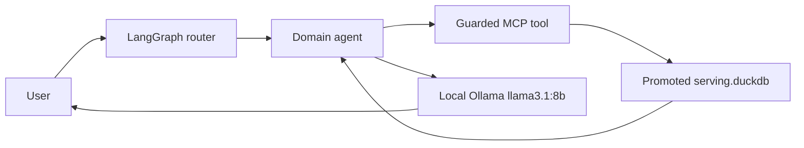

# Capacity Assistant Agentic Architecture

Capacity Assistant is the local **Capacity Planning Assistant**. It routes questions to five existing domains: capacity, yield, OEE degradation risk, forecast, and CapEx. Operational numbers must come from read-only data tools, not model memory.

Implementation lives under `capacity_assistant/agentic/` and `capacity_assistant/backend/`. The baseline model and router are `llama3.1:8b`, configured in `capacity_assistant/config.yaml`.

## Safety and behavior

- DuckDB and Raw SQLite access is read-only.
- SQL accepts only one parsed/allowlisted `SELECT` or approved `WITH` statement.
- Identifiers, row limits, and time limits are validated.
- Client errors are sanitized and local logs retain correlation details.
- CORS is restricted to configured localhost origins.
- Capacity Assistant binds to `127.0.0.1` by default.
- Ollama and tool calls require timeouts and graceful degraded behavior.
- Model and tool output is escaped before the browser renders a small sanitized Markdown subset.

The approved SSE behavior is true cancellable graph/model event streaming. The current backend still emits a completed answer word by word and includes migration-era raw exception handling, so those safety and streaming items are not yet verified as complete.

## Future model evaluation

Alternative local models are future experiments only. Verify exact Ollama tags and licenses before comparing Qwen 3.5 4B-class, Granite 4.2 8B-class, or Qwen 3.5 9B-class candidates. Evaluate tool selection, schema-valid arguments, numerical grounding, unsupported claims, time to first token, total latency, and peak RAM. Load one model at a time on the 16 GB target.
