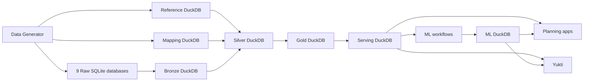

# System Architecture

## Runtime

One FastAPI process serves every page and API on `127.0.0.1:8000`. Capacity Twin Core owns the shared application registry, navigation, chart contracts, runtime paths, and release readers.

## Source systems

Raw data represents separate industrial source systems:

| Database | Subject |
|---|---|
| `raw_demand.db` | Demand, customer orders, constrained plans, allocations |
| `raw_product.db` | Products, BOMs, routes, sourcing |
| `raw_site.db` | Sites, calendars, shift rules |
| `raw_machine.db` | Equipment, inventory, logs, cost references |
| `raw_test.db` | Test types, test times, test parameters |
| `raw_yield.db` | Target and measured yield inputs |
| `raw_execution.db` | Execution, schedules, lot route movements |
| `raw_inventory.db` | Inventory, receipts, shipments, service policies |
| `raw_npi.db` | NPI programs, gates, evidence, ramp, risks |

Raw databases never contain analytical comparison bands. Planning versions remain because they represent real forecast vintages.

Reference and Mapping are governed source controls. They are not Raw source transactions.

## Publication

Every generated source bundle and pipeline run is immutable.

1. Generate a candidate.
2. Validate schema, checksums, keys, dates, units, row counts, and reconciliations.
3. Build ML outputs against the same Serving release.
4. Promote one compatible release through `release_current.json`.

Readers pin one release for the complete request.

## Applications

| Route | Application |
|---|---|
| `/` | Capacity Home |
| `/explorer/` | Data Explorer |
| `/capacity-analysis/` | Capacity Analysis |
| `/decision-intelligence/` | Decision Intelligence |
| `/scenario-planning/` | Scenario Planning |
| `/demand-supply-planning/` | S&OP Planning |
| `/npi-ramp-planning/` | NPI Ramp Planning |
| `/operations-flow/` | Operations Flow |
| `/data-operations/` | Data Operations |
| `/documentation/` | Documentation |

Yukti is a shared widget. It has no standalone page. Its API uses `/shared/api/yukti/*`.

## UI

The UI uses Graphite and Dark Cyan for structure. Analytical charts use semantic colors. All chart assets are local. Apache ECharts does not require a CDN.

Every page uses the same navigation, page header, status format, and Yukti widget.
