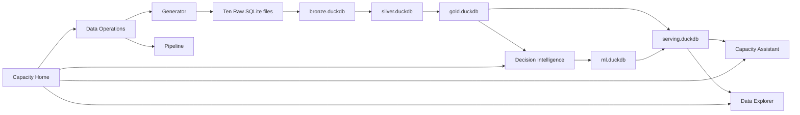

# System Architecture

## Approved essential architecture

The project is a local telecom/networking manufacturing digital twin with five root
applications and one shared core package. Capacity Home launches Data Explorer,
Decision Intelligence, Capacity Assistant, and Data Operations. Capacity Twin Core
contains shared runtime, job, and business contracts.

Runtime files belong under `CAPACITY_TWIN_HOME`, not in the repository. The approved run layout places every candidate under `artifacts/<run_id>/`, stores validation and provenance in `manifest.json`, and promotes it by atomically changing `current.json`. Downstream steps read upstream databases without modifying them.

## Data contracts

- Actual and execution dates: 2023-01-01 through 2026-10-31.
- Forecast dates: 2026-11-01 through 2027-12-31.
- Demand types: direct customer, spare, service, and BOM-dependent.
- Product routes apply to made children as well as completed parents.
- Capacity behavior is explicit for alternative, serial, paired-fixture, multi-DUT, standalone, shared-pool, and dedicated resources.
- Raw noise is intentional only when a named rule and truth-manifest outcome exist.
- Promotion requires schema, checksum, key, date, quantity, cardinality, and capacity reconciliation checks.

## Serving and UI

The target is one FastAPI process bound to `127.0.0.1`. It serves:

- `/` — compact launcher for all four workspaces;
- `/capacity-assistant/` — Capacity Assistant;
- `/chat/` — compatibility redirect;
- `/explorer/` — Data Explorer;
- `/decision-intelligence/` — five ML workflow dashboards;
- `/data-operations/` — Generator and Pipeline tabs;
- `/api/health` — API, promoted-data, and optional Ollama status.

The Graphite/Dark Cyan UI uses `#F7F8FA`, `#20242A`, `#006D77`, `#1597A5`, and `#D9F0F2`. Ollama being offline may degrade Capacity Assistant but must not make Data Explorer unavailable.

## Verification boundary

Each root app owns its configuration, implementation, and tests. Generated data and
model artifacts remain external. Candidate publications are validated before their
small current-pointer file changes. Dashboard and job behavior must pass the app-owned
test suites before a release is accepted.
